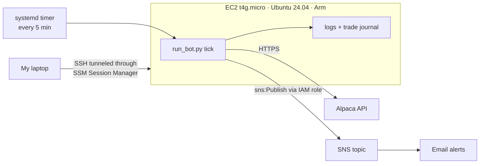

# Overnight Trading Bot

A bot that buys a stock ETF right before the market closes and sells it right after the market opens the next morning, so it only ever holds overnight. It trades through Alpaca's API and runs on its own on an AWS EC2 server, so my laptop doesn't need to be on.

It's currently paper trading TQQQ (a 3x leveraged Nasdaq-100 ETF) with a $500 account.

> This is a personal learning project, not financial advice. Leveraged ETFs can lose a lot of money very quickly.

## Why overnight?

I kept reading about the "overnight anomaly": if you split the stock market's return into what happens while the market is open (open → close) and what happens while it's closed (close → next open), nearly all of the long-run gain has come overnight. I wanted to check that myself before building anything, so the first thing I wrote was a backtest.

Using SPY data from 1993 to 2026:

| | Return per year | Volatility | Worst drawdown |
|---|---|---|---|
| Buy and hold | 10.9% | 18.5% | -55% |
| Overnight only (close → open) | 10.1% | 10.6% | -33% |
| Intraday only (open → close) | 0.7% | 15.2% | -69% |
| Overnight + 200-day trend filter | 9.1% | 6.4% | -13% |

So the effect is real, but it isn't free money. Overnight-only roughly matches buy-and-hold with about half the time in the market, and it doesn't beat it, especially after taxes since every trade is short-term. The bigger lesson was about costs: trading twice a day means every 0.01% of slippage costs about 5% a year. That's why execution details ended up mattering more than anything else.

The **200-day trend filter** (only hold overnight when the price is above its 200-day average) was the most useful rule I tested. It gave up a little return and cut the worst drawdown from -33% to -13%.

### Why TQQQ

I also tested 2x and 3x leveraged ETFs. From 2018 to 2026, with the trend filter and trading costs included:

| | Return per year | Worst drawdown |
|---|---|---|
| TQQQ, this strategy | 28.7% | -47% |
| TQQQ, buy and hold | 35.3% | -82% |

Buy-and-hold TQQQ made more, but it also fell 82% at one point. The overnight version captured most of the gain with a much smaller worst case. I'm skeptical of these numbers though: 2018–2026 was a great period for the Nasdaq, and when I simulated a 3x Nasdaq fund through the 2000–2002 crash, $500 dropped to about $264 even with the trend filter. So I'm paper trading it first.

### Adding the "overnight drift" paper

After the first version was running, I read the NY Fed's [The Overnight Drift](https://www.newyorkfed.org/medialibrary/media/research/staff_reports/sr917.pdf) (Boyarchenko, Larsen & Whelan, Staff Report 917). Their argument is that the overnight gain comes from market makers who get stuck buying when people sell into the close. They want to be paid for holding that risk overnight, so prices tend to bounce back, and the bounce is much bigger after sell-offs than after rallies.

I checked whether that shows up in plain daily SPY data (`research/overnight_drift.py`). It does:

| What happened that day | Average next overnight return |
|---|---|
| Up day | 2.3 bps |
| Down day | 6.1 bps |
| Down day with VIX ≥ 20 | 8.7 bps |

It held in both 1993–2009 and 2010–2026. That created a conflict with my trend filter, which sits out exactly when prices are falling. So I tested variants. Only trading after down days was worse, because up-day nights still earn more than the trading cost. The version that worked was **"hold if the trend is up OR the price fell today"**:

| | Current rule (trend only) | Trend OR down day |
|---|---|---|
| SPY 1994–2026 | 8.3%/yr, worst -13% | 10.1%/yr, worst -20% |
| TQQQ 2011–2026 | 29.1%/yr, worst -47% | 36.5%/yr, worst -52% |

It was better in every period I tested, at the cost of a deeper worst case, since it now holds some nights during bear markets. I tested 9 variants, which is a lot of chances for something to look good by luck. This one came from the paper's hypothesis rather than from mining the data, so I'm running it in paper trading to see if it holds up.

## How it trades

Every 5 minutes the bot wakes up, looks at the time and the account, and does at most one thing:

1. **3:40–3:58 pm ET:** if it isn't holding anything, and either the price is above its 200-day average or the price fell today, buy as many whole shares as the cash allows (limit order, capped 2% above the last price).
2. **Right after the 4:00 pm close:** queue a market sell, which executes at the next morning's open.
3. **9:30 am ET:** the sell fills, and the cycle repeats that afternoon.

Half-days and holidays come from Alpaca's market calendar.

I originally used closing-auction and opening-auction orders, which give the cleanest prices. It turned out Alpaca's paper-trading simulator never fills auction orders. My first three buys all expired even though the price was below my limit. So I added a "regular" mode that uses normal orders, which costs about a penny a day at this size. Auction mode is still in the code for live trading.

### Safety rules

These are the parts I spent the most time on, because a bug here costs real money:

- **No day trades.** It never sells shares on the same day it bought them.
- **No borrowing.** Orders are sized against actual cash (not margin buying power) at the limit price, so a fill can never exceed the account balance.
- **No settlement violations.** Alpaca accounts under $2,000 are "limited margin" and can trade on unsettled funds, so the daily round trip doesn't trigger good-faith violations.
- **Drawdown stop.** New buys stop if equity falls a set percentage below its peak. Sells always still happen.
- **Kill switch.** A `STOP` file blocks new buys. `run_bot.py flatten` sells everything immediately.
- **Account checks.** If Alpaca flags the account as blocked, or ever counts a day trade, the bot stops buying and alerts me.
- **Paper by default.** Live trading needs both `ALPACA_PAPER=false` and a `--live` flag, so it can't happen by accident.

## Running it on AWS

The bot first ran on my Mac with launchd. That failed in the most predictable way possible: my laptop was asleep during the buy window and it missed a trade. So I moved it to EC2.



- **Compute:** EC2 t4g.micro (AWS Graviton, Arm) running Ubuntu 24.04, with 1 GB of swap so installing pandas doesn't run out of memory.
- **Scheduling:** a systemd service + timer (`deploy/systemd/`). It survives reboots, and the logs go to `journalctl` as well as `logs/bot.log`.
- **Alerts:** every buy, sell, skip and error is published to an SNS topic that emails me. Fills include the P&L, like `SOLD 6 TQQQ @ $75.02: +$5.52 (+1.24%)`.
- **No stored AWS keys:** the server gets temporary credentials from an IAM role. The role's only permission is `sns:Publish` on that one topic, plus the AWS-managed policy Session Manager needs.
- **No open inbound ports:** the security group has zero inbound rules. I connect with Session Manager, and `ssh`/`rsync` are tunneled through it via a `ProxyCommand`, so access is controlled by IAM instead of an IP allowlist.
- **Secrets:** the Alpaca keys live only in `.env` on the server (`chmod 600`) and are never committed.
- **Cost:** about $10/month (instance, disk and public IPv4), currently covered by AWS credits.

## Trade journal

Every fill is appended to `journal/trades.csv`: time, side, shares, price, and P&L when a sell closes a buy. The bot tracks which order IDs it has already recorded, so a fill is never written twice.

```bash
python run_bot.py trades     # journal plus totals
python run_bot.py report     # P&L rebuilt from Alpaca's order history
python run_bot.py status     # account, position, open orders
```

## Project layout

```
overnight/
  strategy.py   entry filters, shared by the backtest and the live bot
  backtest.py   close-to-open backtest with costs, taxes, whole-share sim
  decide.py     pure decision logic for one tick (no network calls)
  broker.py     thin wrapper around the Alpaca API
  bot.py        runs a tick: snapshot → decide → act → notify
  journal.py    trade journal + P&L
  config.py     settings from .env (and optional per-profile overrides)
research/
  overnight_drift.py   tests the NY Fed overnight-drift findings on SPY and TQQQ
run_backtest.py, run_bot.py   command-line entry points
deploy/systemd/               the service and timer used on EC2
scripts/deploy.sh             rsync to the server and run the tests there
tests/                        42 tests
```

Keeping `decide.py` free of network calls made the most important logic easy to test. The tests in `tests/test_bot_flow.py` run the real `tick` function through full simulated trading days against a fake broker, including weekends, half-days, missed windows and the kill switch, and check that it never day-trades and never spends more cash than it has.

## Running it yourself

```bash
python3 -m venv .venv && .venv/bin/pip install -r requirements.txt
cp .env.example .env              # add Alpaca paper keys
.venv/bin/pytest -q
.venv/bin/python run_backtest.py --ticker SPY --trend 200 --yearly
.venv/bin/python run_bot.py status
```

To deploy to a server set up like mine (an `overnight-bot` entry in `~/.ssh/config`), run `scripts/deploy.sh`. Then install the two files in `deploy/systemd/` into `/etc/systemd/system/` and run `sudo systemctl enable --now overnight-bot.timer`.

## What's next

- Run it on paper for a few weeks and compare real fills against the backtest
- GitHub Actions to run the tests and deploy automatically on every push
- A CloudWatch alarm that auto-recovers the instance if the hardware fails
- Possibly move it to Lambda + EventBridge + DynamoDB, which would cost about $0/month
